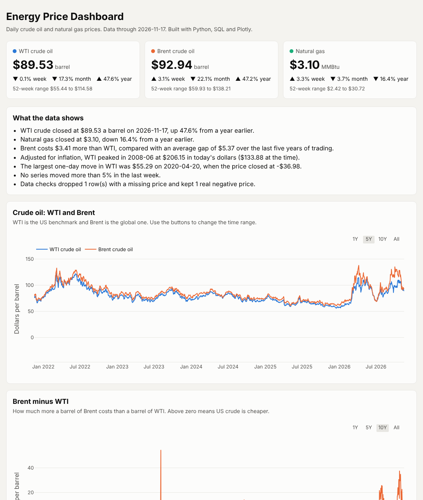

# Energy Price Dashboard

An interactive dashboard that tracks daily crude oil and natural gas prices, built from a small Python and SQL pipeline.



The dashboard is one HTML file: [docs/index.html](docs/index.html). Download it and open it in a browser, or run the pipeline to rebuild it with today's prices.

## Why I built it

I spent five years in logistics, where fuel is one of the largest costs and nobody controls the price. I wanted a single page that answers the questions an operations or finance team asks: where are prices today, how fast are they moving, and is this high or low compared with the past?

## What it does

1. **Download** daily WTI crude, Brent crude and Henry Hub natural gas prices, plus the monthly US consumer price index (`src/fetch.py`).
2. **Check and load** the data into SQLite (`src/load.py`). It drops rows with a missing price, removes duplicate dates, measures the longest gap between trading days, and records what it found in a `data_quality` table.
3. **Calculate metrics in SQL** (`sql/metrics.sql`):
   - latest price against a week, a month and a year earlier, using the last trading day on or before each date
   - day-over-day change with `LAG`, and 30- and 90-day moving averages with window functions
   - the Brent minus WTI gap, from a self-join on date
   - inflation-adjusted WTI, by joining monthly prices to CPI
   - the ten largest one-day moves
4. **Flag alerts** when a price moves more than 5% in a week (`src/metrics.py`).
5. **Build the dashboard** with Plotly, and a Markdown summary (`src/dashboard.py`).

## What the data shows

Snapshot with data through 2026-11-17. Full tables are in [reports/summary.md](reports/summary.md).

- WTI crude closed at **$89.53** a barrel, up 47.6% from a year earlier but down 17.3% in the last month.
- Natural gas closed at **$3.10**, down 16.4% from a year earlier.
- Brent costs **$3.41** more than WTI, below the five-year average gap of $5.37.
- Adjusted for inflation, WTI peaked in June 2008 at **$206.15** in today's dollars ($133.88 at the time). Today's price is less than half of that.
- Natural gas spiked to $30.72 on 2026-01-23 and had fallen to $4.40 ten days later. The 90-day average barely moved, which is why the dashboard shows both lines.

## A data problem worth knowing about

On 2020-04-20 WTI closed at **-$36.98**. That is a real price, not a bad row: storage was full and sellers paid buyers to take oil. A check that rejects negative prices would delete the most important day in the series, so the pipeline keeps it and counts it. It also changed one metric: the "largest moves" table uses dollars, because a percent change across a negative price is meaningless.

## How to run it

```bash
pip install -r requirements.txt
python run.py     # download, check and load, rebuild docs/index.html
pytest            # 8 tests on small made-up tables, no internet needed
```

## Limits

- **These are benchmark prices.** They are what crude and gas trade for on the market, not what a business pays for diesel or a utility bill. Retail fuel follows crude with a delay and adds refining, tax and delivery costs.
- **The 5% alert is a simple rule.** It does not account for how volatile each series normally is. Natural gas moves 5% far more often than crude.
- **Inflation adjustment uses overall CPI**, not an energy-specific index, and the latest CPI month lags the price data by about two months.
- **The data arrives through a mirror.** The files come from the open [datasets](https://github.com/datasets) project, which republishes EIA and BLS figures. If the mirror stops updating, so does the dashboard.

## What I would add next

- US retail diesel prices from the EIA API, to measure how long crude moves take to reach the pump.
- An alert threshold based on each series' own volatility.
- A scheduled run so the dashboard refreshes every trading day.

## Tools

Python, pandas, SQLite, SQL (window functions, CTEs, joins), Plotly, pytest.

## Data sources

US Energy Information Administration (prices) and US Bureau of Labor Statistics (CPI), via [datasets/oil-prices](https://github.com/datasets/oil-prices), [datasets/natural-gas](https://github.com/datasets/natural-gas) and [datasets/cpi-us](https://github.com/datasets/cpi-us).
